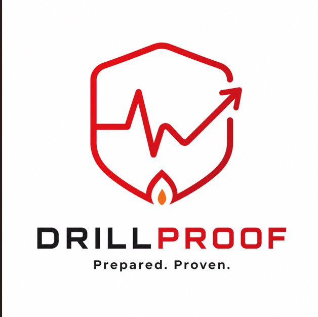

# DRILLPROOF

<p align="center">
  
</p>

<p align="center">
  <strong>Prepared. Proven.</strong><br>
  <em>Institutional Emergency Readiness & Verification Platform</em>
</p>

<p align="center">
  <a href="#key-features">Features</a> &bull;
  <a href="#how-drillproof-works">How It Works</a> &bull;
  <a href="#supported-emergency-scenarios">Emergency Scenarios</a> &bull;
  <a href="#technology-stack">Tech Stack</a> &bull;
  <a href="#installation-and-local-development">Installation</a> &bull;
  <a href="#user-roles">User Roles</a> &bull;
  <a href="#current-project-status">Project Status</a>
</p>

---

## Project Identity

**DRILLPROOF** is a specialized institutional emergency preparedness and disaster management platform designed for educational campuses, commercial workplaces, healthcare institutions, and industrial facilities. 

Most institutions maintain safety plans, equipment registers, and contact lists on paper or within dormant binder manuals. However, static documents cannot verify whether occupants know their evacuation routes, whether emergency equipment is functional, or whether discovered bottlenecks are resolved.

DRILLPROOF bridges the gap between documented safety plans and actual emergency execution. It transforms passive compliance documents into living digital guidance, structured routine inspections, accountable mock drills, and verified corrective action tracking.

---

## The Problem

Institutions face recurring breakdowns when managing physical safety before and during crises:

- **Fragmented Safety Information:** Emergency manuals, floor blueprints, and call lists are scattered across physical binders, static PDFs, and disparate spreadsheets.
- **Unverified Operational Readiness:** Leadership assumes preparedness exists because an evacuation plan is on file, without verifiable data on actual drill performance.
- **Unmanaged Safety Deficiencies:** Blocked exit corridors, expired extinguishers, and faulty battery backups identified during audits often go unassigned and forgotten.
- **Uncoordinated Emergency Drills:** Mock exercises are conducted infrequently, measured with manual stopwatches, and lack floor-by-floor warden accountability.
- **Inaccessible Building Emergency Information:** During emergencies, occupants do not have time to install apps, log in, or search for instructions.
- **Lack of Centralized Metrics:** Facility directors and safety officers lack a unified view of readiness scores across multiple buildings, wings, and teams.

---

## Key Features

### 1. Readiness Dashboard
- **Institutional Readiness Indicator:** Real-time composite score (0–100%) dynamically calculated based on inspection recency, drill benchmark compliance, and resolved corrective actions.
- **Multi-Building Status Overview:** High-level summary of registered campus buildings, floor counts, active issues, and overdue audits.
- **High-Priority Remediation Widget:** Immediate visibility into critical safety bottlenecks with 1-click status transitions.
- **Operational Activity Stream:** Chronological audit trail of recorded inspections, completed drills, and closed safety tickets.
- **Quick Action Triggers:** Rapid creation shortcuts for starting drills, recording inspections, logging hazards, and managing buildings.

### 2. Buildings & Floor Plans
- **Multi-Building Registry:** Support for diverse campus structures, including academic blocks, administration towers, student residences, and science laboratories.
- **Interactive Architectural Floor Plans:** High-contrast SVG floor schematics displaying structural walls, rooms, primary corridors, and egress routes.
- **Safety Asset Pinpointing:** Spatial mapping of fire extinguishers, AED defibrillators, first-aid kits, emergency lighting, and alarm pull stations.
- **Exit Status Monitoring:** Real-time corridor and door swing condition tracking (`Clear`, `Partially Obstructed`, `Blocked`).
- **Dynamic QR Code Generation:** Instant generation of downloadable, location-specific QR codes linking directly to public emergency information.

### 3. Public Emergency Information
- **Zero-Login QR Access:** High-contrast, mobile-first emergency portal (`/building/:slug` and `/emergency/:buildingId`) accessible to any smartphone camera without app installation or authentication.
- **Multi-Hazard Response Guidance:** Immediate step-by-step action tabs for fire, earthquake, flood, medical crisis, and hazardous chemical spills.
- **Clear Operational Boundaries:** High-visibility "What NOT to do" safety warnings to prevent occupant panicking.
- **Muster Point Coordinates:** Precise designated assembly points with capacity indicators and location descriptions.
- **One-Tap Emergency Calling:** Direct dial buttons for Campus Security Control, Local Fire Stations, Police, and Ambulance services.

### 4. Safety Inspections
- **Structured Verification Checklists:** Digital audit forms covering fire extinguishers, emergency exit luminaire backups, corridor clearances, alarm pull stations, and first-aid kits.
- **Three-State Condition Auditing:** Explicit categorization for each asset (`Pass`, `Needs Attention`, `Not Checked`).
- **Automatic Hazard Escalation:** Deficiencies flagged during inspections automatically generate linked corrective action tickets.
- **Session Continuation:** Incomplete inspection sessions are preserved in state, allowing safety officers to resume floor checks without data loss.

### 5. Mock Drills
- **Scenario Simulation Planning:** Scheduled timed drill exercises across distinct hazard categories (Fire, Earthquake, Lockdown, Chemical Spills).
- **Live Stopwatch & Benchmark Comparison:** Real-time drill execution timer comparing actual evacuation duration against pre-configured benchmark targets.
- **Floor-by-Floor Warden Accountability:** Warden check-in system logging cleared zones, timestamps, and accounted occupants versus expected capacity.
- **Observation Logging:** Rapid capture of drill bottlenecks, delayed evacuations, or door swing obstructions, tagged by severity (`Low`, `Medium`, `High`, `Critical`).

### 6. Corrective Actions
- **Traceable Issue Tracking:** Centralized register of all safety findings originating from inspection failures, drill observations, or manual incident reports.
- **Structured Remediation Lifecycle:** Strict four-stage status transitions: `Open` &rarr; `In Progress` &rarr; `Resolved` &rarr; `Verified` (Closed).
- **Accountability Assignment:** Clear role-based ownership, priority levels, and mandatory due dates.
- **Documented Closure Dossier:** Resolution notes and physical verification sign-offs required before issues count toward readiness score improvements.

### 7. Readiness Reports
- **Institutional Analytics:** Multi-parameter evaluation comparing readiness scores across departments, buildings, and risk profiles.
- **Trend Visualizations:** Trajectory tracking for safety score improvements, inspection frequencies, and open issue resolution times.
- **Data Exporting:** CSV data exports for compliance reporting and print-ready safety dossiers for executive briefings.

### 8. Staff & Wardens
- **Institutional Personnel Directory:** Complete roster of campus wardens, safety committee members, and facility engineers.
- **Role Designation:** Explicit assignment of critical responsibilities (Chief Safety Officer, Building Warden, Floor Warden, First Aid Officer, Assembly Coordinator, Facility Manager).
- **Zone Assignments & Training Tracking:** Building and floor assignments linked to certified emergency training dates and renewal statuses.

---

## How DRILLPROOF Works

DRILLPROOF operates on a continuous, closed operational loop:

```
┌────────────────────────────────────────────────────────┐
│                   THE OPERATIONAL LOOP                 │
└────────────────────────────────────────────────────────┘
                           │
                           ▼
                 1. Building Registration
          (Digitize floor plans, exits & assets)
                           │
                           ▼
                  2. Safety Inspection
          (Verify equipment, luminaire & egress)
                           │
                           ▼
               3. Deficiency Identification
          (Flag blocked exits & expired hardware)
                           │
                           ▼
            4. Corrective Action Assignment
          (Assign task, due date & priority level)
                           │
                           ▼
                     5. Remediation
          (Physical clearance & maintenance repair)
                           │
                           ▼
                6. Physical Verification
          (Independent safety sign-off & closure)
                           │
                           ▼
               7. Readiness Score Update
         (Institutional compliance score recalculated)
                           │
                           └──────────────┐
                                          │
                                          ▼
                               (Feeds next inspection &
                                  mock drill exercise)
```

### Complementary Operations
- **Mock Drills:** Stress-test the operational loop with timed evacuation exercises, floor sweeps, and headcount accountability. Observations instantly generate corrective action tickets.
- **Public QR Codes:** Placed at facility entrances and stairwells, ensuring that the latest verified emergency plans and assembly instructions are immediately accessible to occupants without requiring an account.

---

## Supported Emergency Scenarios

DRILLPROOF is built for multi-hazard readiness, supporting distinct operational protocols across diverse crises:

| Hazard Type | Key Preparedness & Response Protocols |
| :--- | :--- |
| **Fire & Smoke** | Stairwell egress clearances, horizontal smoke barrier management, fire extinguisher pressure audits, and outdoor field assembly. |
| **Earthquakes** | Structural exit stability, Drop-Cover-Hold guidance, secondary gas/electrical cutoff points, and open-space muster zones. |
| **Floods & Water Ingress** | Ground-level and basement evacuation, electrical isolation, and vertical evacuation routing to designated upper floors. |
| **Medical Emergencies** | AED defibrillator mapping, first-aid stock verification, horizontal triage corridor clearances, and dedicated ambulance bay staging. |
| **Chemical & Gas Hazards** | Laboratory isolation, emergency power cutoffs, spill containment barriers, and upwind evacuation routing. |
| **Severe Weather & Security** | Internal shelter-in-place refuge areas, door lockdown checks, and roll-call headcount reconciliation. |

---

## Technology Stack

DRILLPROOF is engineered as a desktop-first administrative system with mobile-first public emergency screens:

- **Frontend Framework:** React 18 (`react` `18.3.1`, `react-dom` `18.3.1`)
- **Language:** TypeScript (`typescript` `5.6.3`)
- **Build System & Bundler:** Vite 5 (`vite` `5.4.11`, `@vitejs/plugin-react` `4.3.4`)
- **Routing Engine:** React Router DOM v6 (`react-router-dom` `6.28.0`)
- **Styling Architecture:** Tailwind CSS (`tailwindcss` `3.4.15`), PostCSS, Autoprefixer
- **UI & Architecture Icons:** Lucide React (`lucide-react` `1.16.0`)
- **QR Code Rendering Engine:** `qrcode.react` (`4.2.0`)
- **Data Persistence:** Client-side LocalStorage abstraction layer ([dataService.ts](file:///src/services/dataService.ts)) with strongly-typed schemas, fallback mock data, and full CRUD operations.
- **Demo Dataset:** Pre-seeded with realistic institutional data for the *Northstar Institute of Technology* campus.

> [!NOTE]
> DRILLPROOF currently requires zero external backend infrastructure, database setup, or API keys to run. The entire state persists safely inside the browser's local storage.

---

## Installation and Local Development

### Prerequisites
- [Node.js](https://nodejs.org/) (Version 18.0.0 or higher recommended)
- `npm` (bundled with Node.js) or `pnpm` / `yarn`
- Git installed on your local workstation

### 1. Clone the Repository
```bash
git clone https://github.com/zainkp/DRILLPROOF.git
cd DRILLPROOF
```

### 2. Install Dependencies
```bash
npm install
```

### 3. Run the Development Server
```bash
npm run dev
```
The application will launch locally at `http://localhost:5173/`.

### 4. Build for Production
To perform TypeScript validation and generate an optimized production bundle:
```bash
npm run build
```
Build artifacts are compiled to the `/dist` directory.

### 5. Preview Production Build
```bash
npm run preview
```

---

## User Roles

DRILLPROOF implements clear role-based separation between administrative control and public emergency information:

| Role | Access Level | Responsibilities & Capabilities |
| :--- | :--- | :--- |
| **Administrator** | Authenticated (`/dashboard`) | Full governance: register buildings and floors, configure assembly points, manage staff directories, review readiness scores, and trigger institutional demo resets. |
| **Safety Officer** | Authenticated (`/dashboard`) | Operational management: conduct and record monthly safety equipment inspections, log deficiencies, organize mock drills, and verify corrective action closures. |
| **Building / Floor Warden** | Authenticated / Operational | Emergency coordination: review assigned zones, execute floor sweeps during drills, report door swing bottlenecks, and account for occupant headcounts at muster posts. |
| **Public Occupant / Visitor** | Public (`/building/:slug`) | Instant emergency guidance: scan building QR codes to inspect emergency contacts, evacuation routes, assembly coordinates, and multi-hazard response instructions. Zero login required. |

*Demo Access Note: The prototype includes one-click role switching between Administrator (`Marcus Vance`) and Safety Officer (`Elena Rostova`) within the user profile dropdown.*

---

## Current Project Status

DRILLPROOF is currently an **actively developed, functional frontend prototype and platform demonstration**.

- **Verified Workflows:** The complete operational cycle—from building digitization and QR code generation to inspection audits, live drill stopwatch simulations, and corrective action verification—is fully interactive and operational.
- **Realistic Seed Data:** Pre-loaded with data representing *Northstar Institute of Technology*, featuring multi-floor blueprints for Academic, Administrative, and Student Residence blocks.
- **Client-Side Architecture:** The data layer is cleanly abstracted inside `src/services/dataService.ts`. All state modifications (creating buildings, passing inspections, resolving issues) persist across browser refreshes via `localStorage`.
- **Production Distinction:** This repository demonstrates institutional workflows and frontend system architecture. It does not currently connect to a remote cloud database, automated municipal dispatch systems, or IoT smoke sensors.

---

## Future Scope

Planned enhancements for future iterations of the platform include:

- [ ] **Multi-Tenant Cloud Backend:** Migration of the `dataService` abstraction to a hosted PostgreSQL / Supabase or Firebase database with Row-Level Security (RLS).
- [ ] **SMS & Push Incident Broadcasts:** Web-push and SMS emergency notification dispatch to floor wardens upon drill activation.
- [ ] **Mobile Warden PWA:** Offline-first progressive web application with camera-based asset barcode scanning during equipment audits.
- [ ] **IoT Sensor Integration:** Telemetry ingestion from networked smoke alarms, emergency door sensors, and water-flow switches.
- [ ] **Statutory Compliance Export Engine:** Automated generation of jurisdictional safety documentation formatted for local fire and civil defense audits.

---

## Contributing

Contributions, issues, and feature proposals are welcome:

1. **Fork** the repository on GitHub.
2. **Clone** your fork locally:
   ```bash
   git clone https://github.com/your-username/DRILLPROOF.git
   ```
3. **Create a branch** for your feature or bug fix:
   ```bash
   git checkout -b feature/your-feature-name
   ```
4. **Test your changes** to verify that TypeScript compilation passes:
   ```bash
   npm run build
   ```
5. **Commit your changes** with clear, descriptive commit messages.
6. **Push** to your fork and submit a **Pull Request**.

---

## License

Licensing terms for DRILLPROOF are currently proprietary. All rights are reserved by the original project authors. For commercial inquiries, partnerships, or reuse permissions, please contact the repository maintainers.
